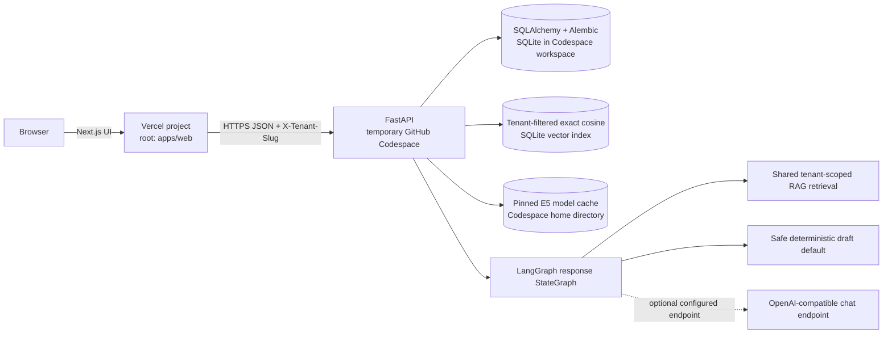

# REVIO Technical Approach Report

**As of:** 17 November 2026. **Delivery status:** Milestones 1–5 are implemented and pushed. The frontend is deployed at <https://revio-ai-smoky.vercel.app>; the API URL is <https://expert-space-orbit-5vqwjw76v5p37p95-8000.app.github.dev>. Frontend routes return HTTP 200, but the Codespaces `/health` redirects to GitHub sign-in (302) and a Vercel-origin preflight returns tunnel HTTP 401. The product is therefore not publicly usable end to end. This report describes the implemented demonstration and zero-cost assessment topology; it does not claim production security.

## System architecture

The monorepo uses Next.js with JavaScript-only application files under `apps/web`, Python/FastAPI under `services/api`, SQLAlchemy/Alembic for relational records, and Sentence Transformers for embeddings. The API default is SQLite. The prepared time-bounded assessment demo uses SQLite and the persistent exact-cosine vector fallback in a personal Codespace workspace; PostgreSQL remains the intended relational production migration target. See the individual milestone sections in [`technical-report.md`](technical-report.md).

The browser client sends `X-Tenant-Slug: revio-demo`. This selects the fictional workspace; it is not authentication, authorization, or an acceptable production tenancy boundary. The prepared instance is for a clearly labeled synthetic demonstration only.

## Data and APIs

The idempotent API lifespan applies Alembic migrations and seeds/synchronizes exactly 45 committed synthetic reviews across Jaipur, Chandigarh, and Ludhiana. It preserves unrelated imported rows. The domain contains tenants, memberships, locations, reviews, imports, analyses, crisis alerts, knowledge documents, response drafts, and response audit events. Uploaded knowledge metadata and vector rows are tenant-scoped. No review-platform import integration is connected.

The API exposes health; review CSV preview/import/list/detail/status; locations and summary analytics; analysis and crisis scans; knowledge document upload/list/detail/reindex/delete/search; and response generate/list/detail/edit/approve/reject/audit endpoints. `/health` executes `SELECT 1` against the configured relational database. It deliberately does not load the embedding model, so it is a database/readiness check, not a full AI readiness check.

## Review intelligence

The default is a deterministic multilingual rules baseline for sentiment and complaint aspects, plus explainable urgency. Optional MuRIL sentiment and MiniLM semantic aspect inference can be explicitly enabled. Current M3 evaluation results on a 36-row fictional single-annotator set:

| Pipeline | Accuracy / micro metric | Macro F1 | Additional evidence |
| --- | ---: | ---: | --- |
| Rule sentiment fallback | 63.89% accuracy | 65.35% | Negative recall 46.67%; mixed-script accuracy 37.50% |
| Optional MuRIL sentiment | 66.67% accuracy | 59.69% | Neutral recall 16.67%; median/p95 42.698/163.579 ms per record in local CPU run |
| Multilingual aspect rules | 87.88% micro F1 | 88.17% | Cleanliness recall 28.57% |

The 17 November local rerun reproduced those fallback metrics and measured 0.044 ms median / 0.090 ms p95 per record. This small evaluation does not establish production quality. The rules remain the default because MuRIL's higher accuracy accompanied lower macro F1 and poor neutral recall. Model details and per-class results are documented in [`model-selection.md`](model-selection.md) and [`evaluation/`](evaluation/).

## Retrieval and response workflow

Knowledge ingestion accepts text-extractable PDF, UTF-8 TXT, and Markdown; stores version/hash/source metadata; creates stable overlapped chunks; and indexes normalized 384-dimensional E5 vectors. Search filters on tenant and ready document IDs, ranks by cosine similarity, applies the configured threshold, and returns cited passages or abstains. Scanned PDF OCR is not implemented.

`intfloat/multilingual-e5-small` is pinned at `fd1525a9fd15316a2d503bf26ab031a61d056e98`. Query/passage prefixes are applied and embeddings normalized. The RAG evaluation used 30 relevant and 6 no-match fictional English/Hindi/Hinglish questions. Measured Recall@1/3/5 was 53.33%/80.00%/100.00%; MRR was 0.7061; thresholded Recall@5 was 93.33%; all six no-match examples abstained. Local warmed CPU query plus retrieval measured 25.19 ms median / 32.54 ms p95. Model RSS after load was 648.07 MB; snapshot files were 470.44 MB. These local measurements are not cloud latency or memory guarantees. See [`knowledge-retrieval-report.md`](knowledge-retrieval-report.md).

Response drafting is a six-node LangGraph StateGraph:

1. `load_review` resolves the review inside the current tenant.
2. `analyze_review` runs/reuses persisted review intelligence for the selected review.
3. `retrieve_policy_evidence` calls the shared tenant-scoped RAG path and retains source citations; flagged chunks are excluded from generation with flags treated as advisory.
4. `generate_response` uses either the safe deterministic template or a configured OpenAI-compatible chat-completions provider.
5. `validate_response` checks selected unsupported amount, timeline, and promise patterns and substitutes a cautious fallback when a pattern is found.
6. `save_draft` persists a versioned draft, analysis snapshot, citations, provider label, validation record, workflow trace, and audit event.

Humans can edit, approve for internal use, or reject. No publish endpoint exists. The demo provider is the default; no live hosted LLM call or response-quality benchmark has been made. Hosted mode sends review text and retrieved policy passages to the configured provider and requires a separate privacy and cost decision.

## Guardrails and privacy boundary

- Review and policy data is treated as untrusted input. Retrieved snippets are cited and labeled untrusted. Heuristic phrase flags do not constitute complete prompt-injection defense.
- Output validation covers selected high-risk claim types only; it is not semantic factuality proof.
- No evidence causes a cautious, non-committal draft; similarity scores are not factual confidence.
- High/critical urgency signals request a human review but do not notify a team.
- Tenant filters are tested for the demo selector. Since the selector is a caller-controlled header, there is no authenticated tenant membership boundary.
- The public assessment service must contain synthetic information only. It is not a secure customer-data service; unauthenticated writes and missing rate limits remain risks.
- No live integrations, OCR, external publishing, authentication, rate limiting, or durable queue are part of the implementation.

## Proposed zero-budget deployment and operations

The prepared backend configuration is .devcontainer/devcontainer.json, services/api/requirements-codespaces.txt, and services/api/scripts/codespaces_bootstrap.py. It leaves machine sizing unconstrained so GitHub can offer types available to the account, sets the previously authorized port 8000 visibility to Public, uses one Uvicorn worker, and keeps SQLite plus the exact-cosine vector index in the workspace. FastAPI lifespan applies Alembic and synchronizes the 45 committed synthetic reviews. The bootstrap adds the six committed synthetic policy files and verifies or rebuilds missing vector rows with the existing embedding pipeline. Codespaces stop/start preserves workspace files; deleting or rebuilding the Codespace loses user-uploaded data, while the committed fictional fixture can be reconstructed. The existing Codespace still must pull this configuration and may need a one-time Ports-panel visibility update.

Render Free is not selected. Its published 512 MB memory cap is lower than the higher 648.07 MB E5 RSS observation; the 17 November E5 rerun measured 426.25 MB, and a full local API diagnostic with multilingual MiniLM L12 measured 689.89 MB after query embedding. These local readings vary and are not Render benchmarks; the current service cannot be shown to fit Render Free safely. No smaller or mock retriever is substituted. The latest model, score, latency, and memory measurements are in the committed retrieval evaluation.

The owner deployed the frontend to Vercel Hobby at <https://revio-ai-smoky.vercel.app>, with monorepo root `apps/web`. Its public bundle was inspected and contains `https://expert-space-orbit-5vqwjw76v5p37p95-8000.app.github.dev` as `NEXT_PUBLIC_API_BASE_URL`. Its six routes returned HTTP 200 in the latest direct check. The Codespaces API request to `/health` redirected to GitHub sign-in (302), and a Vercel-origin preflight was rejected by the tunnel with HTTP 401. This is a port-visibility/authentication-gateway failure before FastAPI, so it does not diagnose CORS middleware. The current source bootstrap defaults to the exact Vercel origin, but the Codespace has not been confirmed to run this revision. Make port 8000 Public and pull/restart the latest `main` before verifying CORS and the end-to-end flow. Wildcard origins are rejected; CORS does not replace authentication. See [deployment.md](deployment.md).

The reported deployment uses personal GitHub Codespaces and Vercel Hobby; the URLs and live verification state are recorded in [deployment.md](deployment.md). Account quota and actual billing were not independently inspected. Codespaces have idle shutdown and a maximum lifetime; this is temporary assessment compute, not reliable public hosting. GitHub Free personal accounts list 120 Codespaces core-hours and 15 GB-month storage. Compute use depends on the selected machine. Vercel Hobby is personal and non-commercial; assessment use must qualify. Do not add a payment method, create a paid trial, or exceed the included allowance.

Production scaling should move relational data to managed PostgreSQL, uploaded content to object storage, and vectors to a server-backed vector database; then add authenticated tenant membership, durable queued processing, backups, observability, request limits, and independent evaluation sets before broad use.

## Local verification and evaluation references

On 17 November 2026, all 62 backend tests passed; frontend ESLint, the Next.js 15.5.29 production build, and npm audit (0 advisories) passed. An isolated HTTP API smoke run initialized a fresh SQLite database, returned health `ok`, counted 45 reviews in the three Indian locations, indexed six policies, retrieved `upi-refunds.md` at similarity 0.90044, and abstained on an unrelated query. The six-step LangGraph workflow generated a demo-fallback draft with citations, accepted an edit, approved it, and recorded generated/edited/approved audit events. Previewing and reimporting the exact synthetic CSV marked all 45 rows as duplicates and retained the 45-review count. Local preflight from the exact Vercel origin passed. Public route checks returned HTTP 200 for all six Vercel pages, but the Codespaces health request redirected to GitHub sign-in (302) and its preflight returned tunnel HTTP 401. Thus local workflow evidence does not establish a functioning public workflow; latest browser console and mobile behavior remain unverified. See [deployment.md](deployment.md).

Evaluation artifacts: [`milestone-3-evaluation.json`](evaluation/milestone-3-evaluation.json), [`milestone-3-muril-evaluation.json`](evaluation/milestone-3-muril-evaluation.json), and [`knowledge_retrieval_results.json`](../data/evaluation/knowledge_retrieval_results.json). The exact external Cynbit rubric was not included with the current task, so this report maps to the assessment categories explicitly listed by the owner rather than claiming rubric-by-rubric certification.
